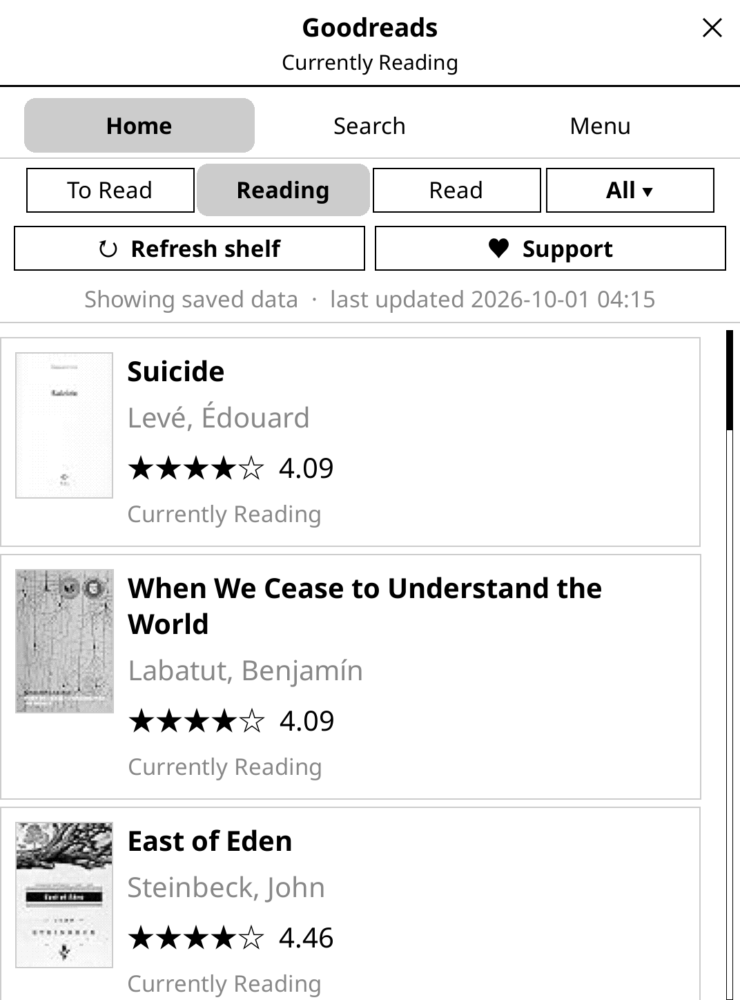
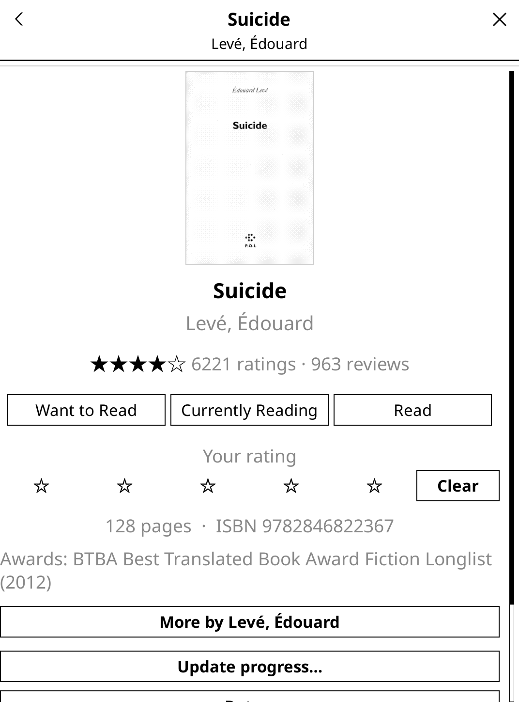

# Goodreads KO Sync

Sync your KOReader reading progress with Goodreads.

### Support the project

If Goodreads KO Sync is useful to you, consider supporting its development — it helps with development, maintenance, bug fixes, and keeping the plugin working as Goodreads changes.

A community KOReader plugin. Install it manually from [Releases](https://github.com/gkgangavarapu/goodreadskosync/releases).

## New in 2.0 — native Goodreads UI (browser-free)

A native Goodreads experience built with KOReader widgets — **no browser engine**. Shelves with covers, Currently Reading, book detail with reviews, search, author pages, on-device caching, and manual refresh.

| Home / shelves | Book detail |
| --- | --- |
|  |  |

## Features

- **Sign in on-device** — Log in to Goodreads directly from KOReader.
- **Automatic sync** — Progress and shelves in the background, queued offline and pushed when you reconnect.
- **Shelf management** — Currently Reading, Read, Want to Read, Did Not Finish, and custom shelves.
- **Automatic book matching** — Link books automatically, or find them by title, author, ISBN, or Goodreads ID.
- **Ratings** — Optionally sync star ratings.
- **Reading Challenge** — Your annual goal, books read and whether you're ahead or behind; set the goal on the device.
- **Sync presets** — Fastest, Faster, Medium or Relaxed, balancing freshness against battery use.
- **Manual controls** — Sync now (with or without a book open), change status, rate books, and find books on Goodreads.
- **Built-in diagnostics** — A connection doctor, plus a one-tap "Export diagnostic log" you can attach to a bug report.
- **OTA updates** — Install plugin updates directly from KOReader.
- **No telemetry** — No analytics or tracking.

## Installation

1. Download the latest release.
2. Unzip it.
3. Copy `goodreadskosync.koplugin` to your KOReader `plugins` directory.
4. Restart KOReader.
5. Open **Tools → Goodreads KO Sync → More → Account → Log in**.

Kindle is tested on real hardware; Android is tested on emulators (Android 11 and 16). Other platforms may work but are less tested.

## Support & Feedback

Found a bug or have a feature request? **[Open an issue on GitHub](https://github.com/gkgangavarapu/goodreadskosync/issues)**.

Please include a diagnostic report: open the plugin's **Menu** tab, then **Diagnostics > Export diagnostic log**. It writes a single file (path shown on screen) into the plugin's settings folder — `koreader/settings/goodreadskosync/` over USB — with your connection checks, settings and recent activity, and no credentials. On Android the same file lands under `/sdcard/koreader/settings/goodreadskosync/`.

If you enjoy using the plugin, the best way to support continued development is: **[Buy Me a Coffee](https://buymeacoffee.com/gkgangavarapu)**

## Important

This is an unofficial community project and is not affiliated with Goodreads, Amazon, or KOReader.

## License

MIT — see [LICENSE](LICENSE).
